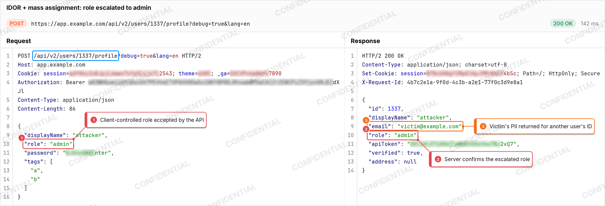

<div align="center">

# snapshotting-http-requests

*Burp-style request/response screenshots for your report, without Burp*

[What it can do](#what-the-agent-can-do) • [Installation](#installation) • [Usage](#usage) • [Limitations](#limitations)

</div>



An agent skill that turns a real HTTP exchange into a report-ready PNG: method, URL and status in a header bar, the request and response with Burp's colours, the evidence boxed with numbered notes, and secrets blurred. It recreates the look of the [Snapshot](https://github.com/noverdy/burp-snapshot) Burp extension in plain Node, with no npm packages, browser or Burp involved.

## What the agent can do

With this skill loaded, an agent can:

- send a raw HTTP/1.1 request exactly as written and save the raw response and its timing (`send.mjs`)
- render the exchange side by side or stacked, light or dark, as a flat report card or a showcase window
- box the evidence by text, JSON key, header, parameter or line, with callouts or a numbered legend
- blur auth headers, cookies, tokens and passwords automatically, drawing the blur over random characters so the secret never reaches the image
- pretty-print JSON, decode chunked and gzip/brotli bodies, and colour HTML and form bodies
- centre the visible window on a mark deep inside a long response

## Installation

The agent needs Node 18 or later. Install just this skill:

```bash
npx skills@latest add noverdy/skills --skill snapshotting-http-requests
```

It also comes with the whole collection; see [Installation](../../README.md#installation). The skill itself lives in [`skills/reporting/snapshotting-http-requests`](../../skills/reporting/snapshotting-http-requests).

## Usage

Ask for the snapshot alongside the finding:

```text
Make a snapshot of the IDOR request and response for the report, and box the leaked email.
```

The agent saves the exchange to `request.txt` and `response.txt`, writes a small `spec.json`, and renders it:

```bash
node scripts/render.mjs spec.json snapshot.png --text
```

```text
wrote snapshot.png (3008×1028)
request: hid Sec-Fetch-Site, hid Accept-Encoding
request: redacted cookie session (kept last 4); Cookie theme; Cookie _ga (kept last 4); Authorization (kept last 4); JSON password (kept last 4)
response: redacted cookie session (kept last 4); JSON apiToken (kept last 4)
mark 4: response line 9: "\"email\": \"victim@example.com\""
```

The [`idor`](snapshotting-http-requests/idor) folder has the spec behind the image above. Every option is in [`reference/spec.md`](../../skills/reporting/snapshotting-http-requests/reference/spec.md).

> [!IMPORTANT]
> A snapshot shows the bytes that were really sent and received. The renderer only redacts, hides noise headers, pretty-prints and trims long bodies; it has no way to edit a value.

## Limitations

- The bundled fonts cover ASCII, Latin-1 and a few symbols. CJK text and emoji are drawn as `?`, and the agent is told which characters were replaced.
- `send.mjs` speaks HTTP/1.1. For HTTP/2 the agent captures with `curl --http2 -v` instead.
- HTML and XML bodies are coloured but not re-indented, so minified pages wrap as long lines.
- The Burp extension's Intruder results table, templates and AI markup are not part of the skill.

<details>
<summary>How it draws without dependencies</summary>

Node has no font renderer, so the skill ships a glyph atlas (`assets/atlas.bin`, 145 KB): JetBrains Mono and Inter pre-rendered at 2x by a real font engine. The renderer copies glyphs from the atlas, draws shapes from signed distance functions for anti-aliased edges, blurs with a box filter, and writes the PNG with `node:zlib`.

To change fonts, sizes or the character set, download the TTFs (JetBrains Mono Regular and Italic, Inter Regular and Bold) and run `python3 scripts/build-atlas.py <font dir>` from the collection root; it needs Pillow. Both fonts are under the SIL Open Font License; the licences are in the skill's [`assets/fonts/`](../../skills/reporting/snapshotting-http-requests/assets/fonts).

</details>
